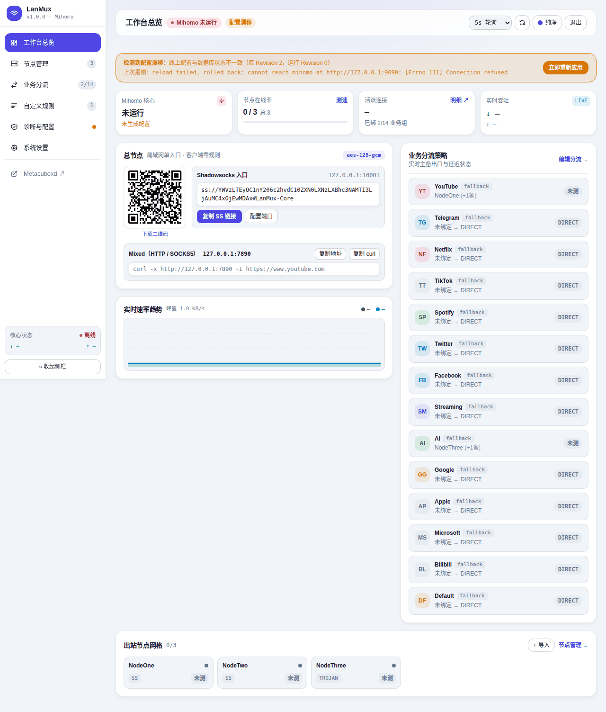
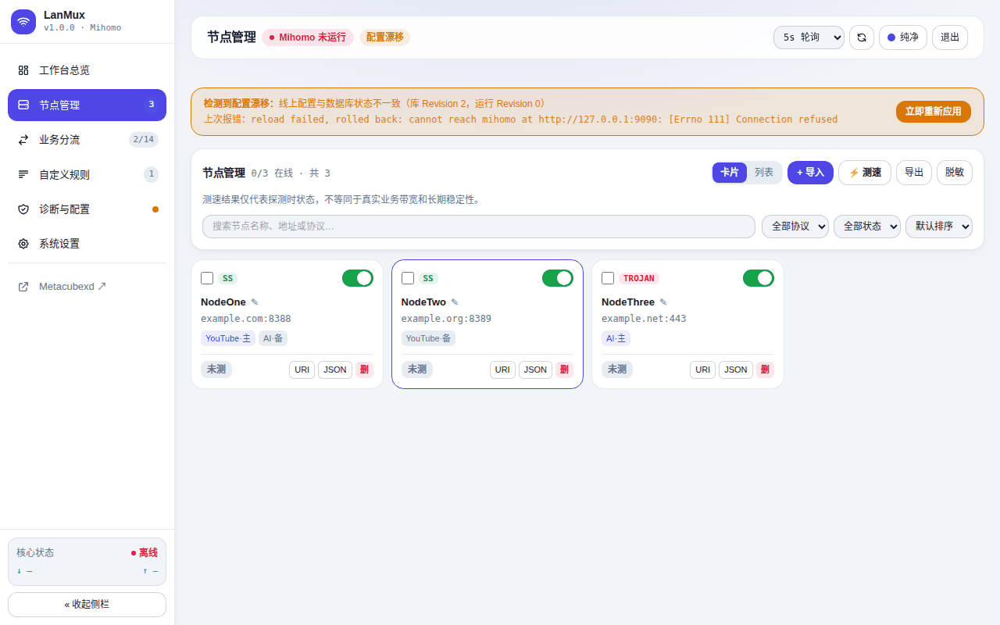
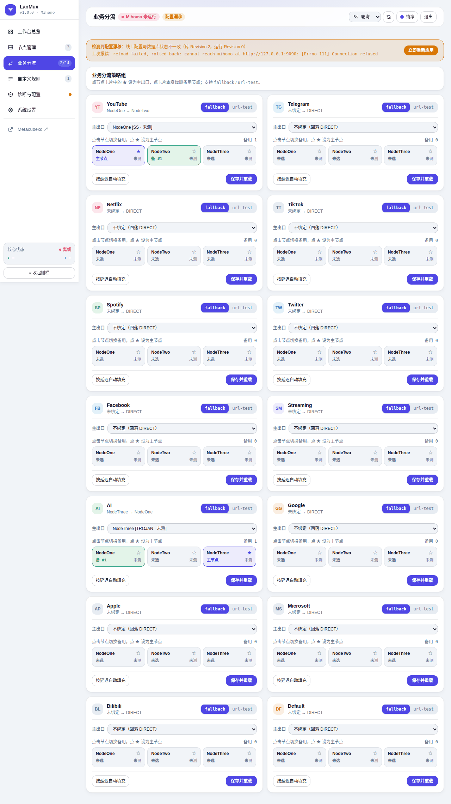
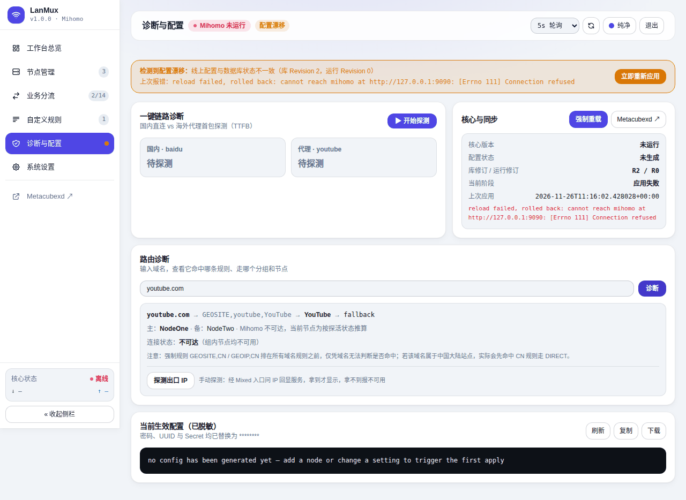
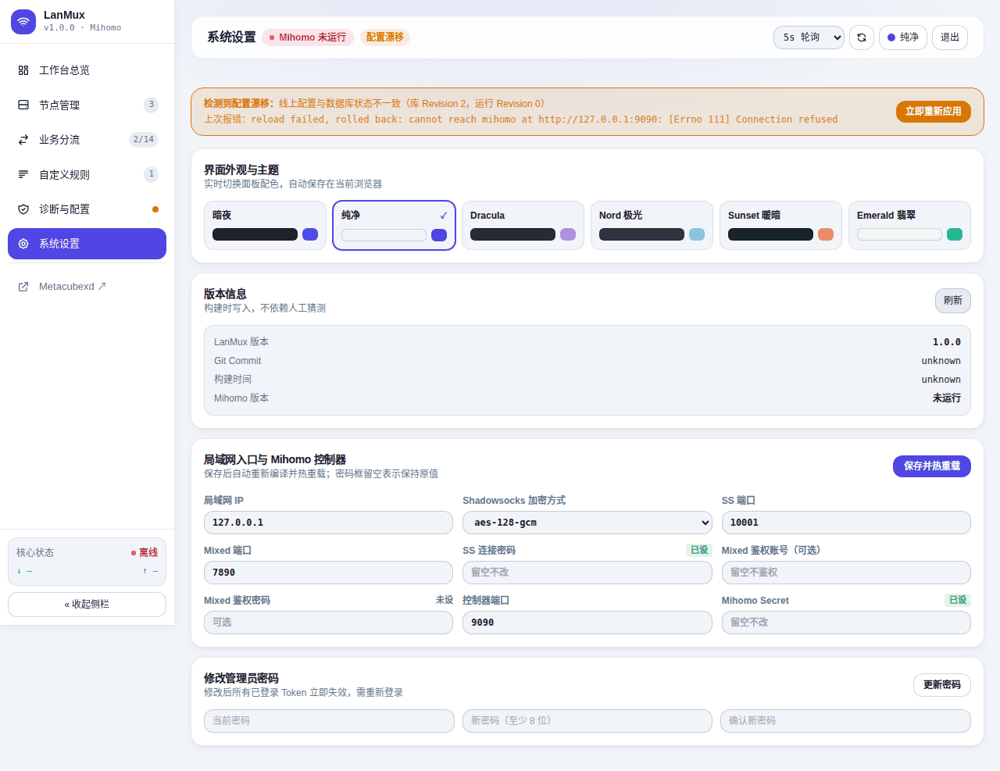

LanMux — 多节点聚合智能分流系统

<p align="center">
  <strong>一个入口，多个节点，按业务智能分流。</strong>
</p>
<p align="center">
  基于 Mihomo 的局域网代理聚合与智能分流管理系统
</p>
<p align="center">
  
  
  
  
  
</p>

⸻

目录

* 项目简介
* 工作原理
* 核心特性
* 适用场景与边界
* 环境要求
* 快速开始
    * 原生安装
    * Docker 部署
    * 开发者 / 源码构建
* 功能说明
    * 统一代理入口
    * 节点管理
    * 业务分流
    * 自定义规则
    * DNS 与流量嗅探
    * 链路诊断
    * 管理面板
* 客户端接入
* 配置与端口
* 升级与迁移
* 卸载
* 安全与隐私
* 故障排查
* 项目结构
* 开发与测试
* 更新记录
* 免责声明
* 许可证
* 致谢

⸻

项目简介

LanMux 是一个基于 Mihomo 的局域网代理聚合与智能分流系统。

它运行在局域网内的常驻设备上，例如 Linux 小主机、NAS、服务器或其他 Linux 环境，将多个 VPS 代理节点统一纳管，并通过 Web 管理面板完成节点管理、业务分流、规则配置、测速与链路诊断。

LanMux 将复杂的代理节点与分流策略集中在服务端管理。手机、电脑及其他支持 Shadowsocks 或 HTTP/SOCKS5 代理的客户端，只需要连接 LanMux 提供的统一入口即可。

节点更换、业务分流策略调整、备用节点配置等操作均在服务端完成，客户端不需要反复修改代理配置。

部署：推荐原生 systemd 安装，适合长期跑在 Linux 设备上（见「快速开始 / 原生安装」）；想快速试用也可以直接拉预构建镜像用 Docker 部署（见「快速开始 / Docker 部署」）。

设计目标

* 统一入口： 将多个代理节点整合为一个局域网代理入口。
* 服务端分流： 按业务类型自动匹配代理策略，不依赖客户端规则。
* 集中管理： 通过 Web 面板统一管理节点、业务绑定与自定义规则。
* 可靠应用： 配置变更经过校验，重载失败时自动尝试回滚。
* 轻量部署： 使用 SQLite、FastAPI 与 Mihomo，无需额外部署数据库或复杂中间件。
* 兼容旧安装： 支持 Fenliu / LAN Proxy Hub 旧版本迁移，尽可能保留原有数据与配置。

⸻

⸻

工作原理

LanMux 采用服务端统一代理架构。

```text
客户端
  ↓
统一代理入口（Shadowsocks / Mixed）
  ↓
代理分流（Mihomo 核心）
  ↓
规则 / DNS / 嗅探
  ↓
业务策略（业务组）
  ↓
节点 A / 节点 B / 节点 C / DIRECT
```

客户端只需连接 LanMux 的 Shadowsocks 或 Mixed 入口。

请求进入服务端后，由 Mihomo 根据 DNS、嗅探信息及规则匹配结果选择对应业务组，最终通过绑定的节点、备用策略或 DIRECT 完成连接。

架构组成

组件	作用
LanMux Web	管理界面与后端 API
FastAPI	提供认证、节点、规则、设置及诊断接口
SQLite	保存节点、规则、绑定关系及系统设置
Config Builder	根据数据库内容生成 Mihomo 配置
Mihomo	执行代理、DNS、嗅探、分流与连接管理
MetaCubeXD	提供 Mihomo 连接与运行状态的辅助管理界面

⸻

核心特性

功能	说明
多节点聚合	统一管理多个 VPS 代理节点
多协议导入	支持 SS、VMess、VLESS、Trojan、Hysteria2、TUIC
单入口接入	提供 Shadowsocks 与 Mixed HTTP/SOCKS5 入口
业务智能分流	内置多种业务策略组，按规则自动选择出口
节点测速	单节点与批量节点测速，记录延迟与状态
主备节点	支持业务组主节点、备用节点与策略切换
自动选择	支持 fallback 与 url-test 策略
自定义规则	支持域名后缀、关键词及 IP-CIDR 等规则
DNS 管理	内置分流 DNS、国内解析及备用解析策略
流量嗅探	支持 HTTP、TLS 与 QUIC 嗅探
链路诊断	检测直连、代理连通性及业务路由
配置校验	生成配置后校验 YAML 与 Mihomo 配置
自动回滚	配置热加载失败时恢复旧配置
Web 管理	通过浏览器管理节点、规则、设置与诊断
二维码接入	生成统一 Shadowsocks 节点链接及二维码
双部署模式	支持原生 systemd 与 Docker All-in-One
数据持久化	SQLite 保存节点、规则、设置与相关状态

⸻

适用场景与边界

适用场景

* 局域网多设备统一代理接入。
* 多 VPS 节点统一管理。
* 按 YouTube、Telegram、Netflix、AI 等业务分配出口。
* 手机与电脑不想重复维护复杂代理规则。
* 在 Linux 小主机、NAS 或服务器上部署代理服务。
* 需要集中管理节点、备用策略和代理运行状态。

LanMux 不是什么

LanMux 不是透明网关、旁路由或全流量接管系统。

它不会自动接管局域网设备的网络流量，也不会修改其他设备的网络配置。

* 不提供 TProxy 透明代理。
* 不提供 iptables / nftables 自动转发配置。
* 不提供 TUN 网关模式。
* 不自动修改路由器 DHCP 或 DNS。
* 不强制其他设备经过 LanMux。

客户端必须主动将代理指向 LanMux，未配置代理的设备不受 LanMux 影响。

⸻

环境要求

原生部署

项目	要求
操作系统	Debian / Ubuntu 系
Armbian	支持
CPU 架构	amd64 / arm64
Python	3.11 或更高版本
服务管理	systemd
网络	能访问代理节点及必要下载源

推荐部署在常驻运行的 Linux 设备上，例如 NAS、迷你主机或服务器。

Docker 部署

项目	要求
Docker	已安装并运行
Docker Compose	Compose v2
CPU 架构	镜像支持的 amd64 / arm64
网络模式	Host 网络

⸻

快速开始

原生安装（推荐）

原生安装方式使用 systemd 管理 LanMux Web 与 Mihomo，适合长期运行的 Linux 设备。

1. 获取项目

```bash
git clone https://github.com/moye-lab/lanmux.git
cd lanmux
```

2. 安装

运行安装器（交互式，会依次问端口和密码）：

```bash
sudo bash install.sh
```

安装器先问局域网 IP、四个端口和加密方式，再问三个密码：管理员密码必填（至少 8 位，登录面板用）；SS 入口密码和 Mihomo 控制器 Secret 回车就是随机生成，装好后在面板里能看到。最后出一张打码确认页，核对无误输入 y 就开始装。

也可以一条命令装完（适合无人值守）。但密码不要写进命令行：命令行会留在 shell history 里，进程存活期间同用户经 `/proc/<pid>/environ` 也可见。先把三个密码（均至少 8 位）写进一个仅属主可读的文件（600），再指给安装器：

```bash
printf '%s\n' "ADMIN_PASSWORD='设置管理密码'" \
  "SS_PASSWORD='设置代理入口密码'" \
  "MIHOMO_SECRET='设置Mihomo控制器密钥'" > /root/lanmux-install.env
chmod 600 /root/lanmux-install.env
sudo LANMUX_INSTALL_ENV_FILE=/root/lanmux-install.env bash install.sh --non-interactive
rm -f /root/lanmux-install.env
```

密码里有单引号时，改用双引号写那一行（如 `ADMIN_PASSWORD="..."`，双引号内的 `$`、反引号、`\` 需在前面加 `\` 转义）；密码里含 `$(` 或反引号时请走交互安装。装完后删掉密码文件。如果以前把密码写进过命令行，顺手清理 history：`history -d <行号>` 删指定行，或 `history -c` 清空当前会话历史（已落盘的 `~/.bash_history` 需手动删行）。

注意端口：管理面板默认 8086，SS 入口默认 10001，Mixed 入口默认 7890，控制器默认 9090。如果某个默认端口已被占用，安装时改一个空闲端口即可。

3. 安装流程

安装器主要完成以下工作：

1. 检查操作系统、CPU 架构、Python 版本与依赖。
2. 检查默认端口是否被占用。
3. 下载并安装 Mihomo。
4. 下载 MetaCubeXD 与 Geodata 资源。
5. 部署 LanMux 程序与 Python 运行环境。
6. 初始化 SQLite 数据库及系统设置。
7. 生成初始 Mihomo 配置。
8. 校验生成的配置。
9. 安装 systemd 服务。
10. 启动服务并等待健康检查通过。

下载完整性校验与镜像说明

安装器与 Docker 构建在下载 mihomo、metacubexd、geodata 后，都会按仓库里 `scripts/asset-checksums.sha256` 的固定 SHA256 强制校验，哈希不匹配就中止安装/构建，已落盘的可疑文件会被删除；已存在的 geodata 文件损坏（哈希不符）也会重新下载而不是跳过。清单里没有对应哈希的版本（例如自行指定旧版 `MIHOMO_VERSION`）同样会被拒绝。geodata 的上游（MetaCubeX/meta-rules-dat）只有一个滚动发布、没有固定 tag，清单钉住的是 2026-11-26 那次快照的哈希与日期；上游更新后安装会明确报错，维护者核对后更新清单才能继续。

下载默认先直连 GitHub，失败才用镜像兜底。三个默认镜像（`gh-proxy.com`、`mirror.ghproxy.com`、`ghfast.top`）都是第三方运营的 GitHub 代理，无官方背书、无 SLA、无可审计性——它们只是传输加速，不是信任根：不论从哪条路下回来，都必须通过上面那份固定哈希才算数，代理投毒最多让下载失败，不可能让坏内容装进系统。直连可用时建议不要配镜像；`MIHOMO_MIRROR` / `GEODATA_MIRROR`（安装器）与 `GITHUB_MIRROR`（Docker 构建）可覆盖或留空只走直连。

4. 访问管理面板

安装完成后，安装器将输出管理面板地址。

默认地址：

http://服务器IP:8086

例如：

http://192.168.1.100:8086

首次启动时，如果尚未配置管理员密码，面板将显示初始设置向导（需填写启动日志里的 Setup Token，见上文「首次初始化：Setup Token」）。

⸻

Docker 部署

普通用户用一条 `docker run` 命令直接拉预构建镜像启动，不用克隆仓库、不用构建。想要用 Compose 管理的，用方式二（需要先克隆仓库取 compose 文件）。源码构建只作开发 / 调试 / 自定义，见「开发者 / 源码构建」。

镜像已发布到 Docker Hub（`moyelab/lanmux`），多架构（amd64 + arm64），N1 与 x86 服务器都能直接拉取。同一镜像也在 GHCR（`ghcr.io/moye-lab/lanmux`），可作备用。

**镜像来源与验证：** 两个 registry 的镜像都由同一 CI 工作流（`.github/workflows/docker-publish.yml`）从同一份源码构建、同一 digest 推送，Docker Hub 不再有手动推镜像的步骤。发布只在打版本 tag（`v*`）时进行，推 main 不会重新发布 `latest`。每个发布镜像都带 SLSA provenance + SBOM，并经 cosign keyless 签名（GitHub OIDC），构建后过 Trivy 扫描（HIGH/CRITICAL 阻断）。拉取后可这样验证两个 registry 是同一镜像、且签名有效：

```bash
docker buildx imagetools inspect moyelab/lanmux:1.0.2 --format '{{json .Manifest}}' | grep -o '"digest":"[^"]*"'
docker buildx imagetools inspect ghcr.io/moye-lab/lanmux:1.0.2 --format '{{json .Manifest}}' | grep -o '"digest":"[^"]*"'
# 两条命令输出的 digest 应当一致
cosign verify --certificate-identity-regexp '.*' \
  --certificate-oidc-issuer https://token.actions.githubusercontent.com \
  ghcr.io/moye-lab/lanmux:1.0.2
```

**Host Network 安全提示：Web 面板、Mixed 入口、Shadowsocks 入口、Mihomo 控制器都直接走宿主机网络（network_mode: host）；9090 控制器与 7890 Mixed 绝不得暴露到公网。Docker 本身拦不住这些端口，访问控制由宿主机防火墙负责。**

容器内包含：

* LanMux Web 后端
* Mihomo
* MetaCubeXD
* Geodata

方式一：一条命令（推荐）

直接拉取预编译镜像启动，无需克隆仓库、无需构建：

```bash
docker run -d --name lanmux --restart unless-stopped --network host --user 0:0 -v lanmux-data:/data moyelab/lanmux:1.0.2
```

首次打开面板会有设置向导（设管理员密码，需填写启动日志里的 Setup Token，见下文「首次初始化：Setup Token」），SS 密码和控制器密钥自动生成。数据保存在 Docker 卷 `lanmux-data` 里，容器删了数据还在。`--user 0:0` 让入口脚本先以 root 修正数据卷属主再降权到 lanmux 用户——从 v1.0.0（全 root 运行）升级时旧卷是 root 的，没有它容器会因 `/data` 不可写而重启循环。

改端口用 `-e` 环境变量（默认面板 8086、SS 入口 10001、Mixed 入口 7890、控制器 9090），例如面板改 8088：

```bash
docker run -d --name lanmux --restart unless-stopped --network host --user 0:0 -v lanmux-data:/data -e LANMUX_WEB_PORT=8088 -e LANMUX_SS_PORT=10002 -e LANMUX_MIXED_PORT=7891 -e LANMUX_CONTROLLER_PORT=9091 moyelab/lanmux:1.0.2
```

方式二：Compose

1. 获取项目

```bash
git clone https://github.com/moye-lab/lanmux.git
cd lanmux
```

2. 配置环境变量

```bash
cp .env.example .env
```

根据需要编辑 .env，修改端口与其他运行参数。默认端口是面板 8086、SS 入口 10001、Mixed 入口 7890、控制器 9090，一般不用改。密码三行可留空：首次打开面板会有设置向导（需填写启动日志里的 Setup Token），SS 密码和控制器密钥自动生成。

3. 拉取预构建镜像并启动

```bash
docker compose pull
docker compose up -d
```

4. 查看运行状态

```bash
docker compose ps
curl -s http://127.0.0.1:8086/health
```

（面板端口改过的话，把 8086 换成实际端口。）

查看日志：

```bash
docker compose logs -f
```

访问：

http://服务器IP:8086

Docker 数据持久化

Docker 部署使用持久化目录保存运行数据。

路径	内容
/data/lanmux.db	SQLite 数据库
/data/mihomo/config.yaml	Mihomo 配置
/data/mihomo/ui/	MetaCubeXD
/data/mihomo/	其他运行时资源

升级或重建容器时，持久化目录不会随容器删除而自动清除。

⸻

首次初始化：Setup Token

首次启动、尚未设置管理员密码时，后端会在启动日志里打印一次性 **Setup Token**，面板设置向导要求填写它才能创建管理员密码；完成初始化后 token 立即失效，setup 端点永久关闭。

查看 token：

```bash
# Docker run 方式
docker logs lanmux | grep -i "setup token"
# Compose 方式
docker compose logs lanmux-web | grep -i "setup token"
# 原生安装（systemd）
journalctl -u lanmux-web | grep -i "setup token"
```

说明：

- token 每次启动重新生成，仅当次启动有效；重启后请看最新日志。
- 安装命令里预置了 `ADMIN_PASSWORD` 时不走设置向导，也就没有 token。
- 登录失败 5 次会锁定 15 分钟（IP 与账号双维度，之后每次锁定时间翻倍，最高 2 小时），锁定期间登录返回 429。
- 可选加固：设 `LANMUX_SETUP_LOOPBACK_ONLY=1` 后，setup 只接受本机（127.0.0.1 / ::1）来源。**默认关闭**：Docker 部署下用户是从局域网浏览器做 setup 的，默认开启会把正常 setup 挡掉；只在能直接在本机浏览器完成 setup 的部署上开启。

⸻

面板默认 HTTP 与 TLS

面板默认走 HTTP（局域网内明文传输管理员密码与会话），设置页会明确提示。局域网内使用时请勿把面板端口转发到公网。

推荐用反代启用 HTTPS（以 Caddy 为例，Nginx 同理）：

```caddyfile
lanmux.example.com {
    reverse_proxy 127.0.0.1:8086
}
```

```bash
# Caddy 一行反代（已有域名解析到本机时）
caddy reverse-proxy --from lanmux.example.com --to 127.0.0.1:8086
```

已有证书、想让面板自身直接启用 TLS 时（仅 Docker 方式）：把证书挂进容器并设置环境变量

```bash
docker run -d --name lanmux --restart unless-stopped --network host --user 0:0 \
  -v lanmux-data:/data -v /path/to/certs:/certs:ro \
  -e LANMUX_SSL_CERTFILE=/certs/fullchain.pem \
  -e LANMUX_SSL_KEYFILE=/certs/privkey.pem \
  moyelab/lanmux:1.0.2
```

证书或密钥缺失时面板会打一条警告并继续跑 HTTP，不会起不来。原生安装请在 `lanmux-web.service` 的 uvicorn 命令行上加 `--ssl-certfile /path/to/fullchain.pem --ssl-keyfile /path/to/privkey.pem`。本项目不生成自签证书。


开发者 / 源码构建

只作开发、调试或自定义镜像时用，不面向普通用户。普通用户直接用上面 Docker 一节的预构建镜像。

1. 获取项目

```bash
git clone https://github.com/moye-lab/lanmux.git
cd lanmux
```

2. 用开发覆盖文件从源码构建并启动：

```bash
docker compose -f docker-compose.yml -f docker-compose.dev.yml up -d --build
```

构建配置在 `docker-compose.dev.yml` 里（与正式 `docker-compose.yml` 同名 service `lanmux`、同样的 context / dockerfile 与 build args）。本地直接跑后端开发服务的办法见「开发与测试」。

⸻

功能说明



统一代理入口

LanMux 提供两种代理接入方式。

入口	默认端口	协议
Shadowsocks	10001	TCP / UDP
Mixed	7890	HTTP / SOCKS5

Shadowsocks

提供一个统一 Shadowsocks 节点。

客户端只需要配置：

* 服务器地址：LanMux 局域网 IP。
* 端口：默认 10001。
* 加密方式：默认 AES-128-GCM。
* 密码：LanMux 设置中的 SS 密码。

面板可直接生成节点链接与二维码，方便手机等设备快速添加。

Mixed HTTP / SOCKS5

Mixed 入口同时支持 HTTP 与 SOCKS5 代理。

默认端口：

7890

客户端可以将其作为 HTTP 或 SOCKS5 代理使用。

该入口支持可选账号密码认证，默认无鉴权，仅适用于可信局域网环境。

⸻

节点管理

LanMux 支持集中管理多种代理协议。



支持的协议

协议	URI 前缀
Shadowsocks	ss://
VMess	vmess://
VLESS	vless://
Trojan	trojan://
Hysteria2	hysteria2:// / hy2://
TUIC	tuic://

节点 URI 导入后由解析器转换为 Mihomo 对应的代理配置。

节点管理功能

* 单条节点导入。
* 批量 URI 导入。
* 节点列表查看。
* 节点名称修改。
* 节点启用与停用。
* 节点删除。
* 原始 Proxy JSON 编辑。
* 单节点测速。
* 全部节点测速。
* 查看节点在线状态与延迟。
* 查看测速失败原因。

批量导入

支持逐行导入节点 URI。

导入过程中，系统逐条处理节点，分别返回成功与失败结果，不会因为单条非法 URI 而直接终止整个批量导入。

节点测速

支持单节点测速与全部节点测速。

全部测速采用并发执行：

* 最大并发数：5。
* 单节点超时：5 秒。
* 测试结果保存到数据库。

测速结果用于辅助判断节点状态与延迟，不代表实际业务流量的稳定性或带宽表现。

⸻

业务分流

LanMux 将常见业务类型划分为独立策略组。

每个业务组可以绑定主节点、备用节点，并选择对应的节点选择策略。



内置业务组

业务组	匹配范围
YouTube	YouTube 相关域名
Telegram	Telegram 域名及 IP 规则
Netflix	Netflix 相关域名
TikTok	TikTok 相关域名
Spotify	Spotify 相关域名
Twitter / X	Twitter 与 X 相关域名
Facebook	Facebook 与 Instagram 相关域名
Streaming	Disney+、HBO、Hulu、Prime Video 等流媒体
AI	OpenAI、Anthropic、Gemini 等 AI 服务
Google	Google 相关域名
Apple	Apple 相关域名
Microsoft	Microsoft 相关域名
Bilibili	哔哩哔哩相关域名
Default	其他未匹配业务

默认分流原则

LanMux 内置常见业务分类，并将国内业务与私有网络流量设置为优先直连。

默认规则优先级包括：

1. 私有 IP 直连。
2. 私有域名直连。
3. 国内域名直连。
4. 国内 IP 直连。
5. 自定义规则。
6. 内置业务分流规则。
7. 默认兜底规则。

规则按配置顺序匹配，首次命中即决定后续处理策略。

业务组绑定

每个业务组可独立设置：

* 主节点。
* 备用节点。
* 节点选择模式。

节点选择模式

Fallback

按预设顺序使用节点。

当主节点不可用时，可切换到备用节点。

适合希望优先使用指定节点，并保留备用线路的场景。

URL-Test

通过健康检查选择符合条件的节点。

适合希望自动选择延迟表现较好的节点的场景。

LanMux 使用 Mihomo 的 url-test 策略，健康检查默认参数：

参数	默认值
测试地址	http://www.gstatic.com/generate_204
间隔	60 秒
超时	5000 毫秒
Tolerance	Mihomo 默认值 50

回退行为

以下两条规则写死不变：

* 组里一个节点都没配 → 编译成 DIRECT（未配置）。
* 组里有节点但全部不可达 → 连接失败，不静默转 DIRECT（这是为了不让境外流量漏真实 IP）。

默认直连业务

Apple、Microsoft、Bilibili 等业务组默认不绑定境外代理节点，初始策略为 DIRECT。

用户可以根据实际需求在面板中调整对应策略。

⸻

自定义规则

LanMux 支持用户在管理面板中添加自定义分流规则。

支持的规则类型

类型	说明	示例
DOMAIN-SUFFIX	匹配域名及其子域名	example.com
DOMAIN-KEYWORD	匹配域名关键词	example
IP-CIDR	匹配 IP 网段	192.168.1.0/24

规则目标

自定义规则可将匹配流量指向：

* 内置业务组。
* DIRECT。
* REJECT。

规则管理

支持：

* 新增规则。
* 修改规则。
* 启用或停用规则。
* 删除规则。
* 按用户设定顺序参与配置编译。

自定义规则位于强制直连规则之后、内置业务规则之前。

因此，用户可以在默认业务分流体系之外进一步定制自己的流量处理方式。

⸻

DNS 与流量嗅探

DNS

LanMux 生成的 Mihomo 配置包含 DNS 分流策略。

主要功能：

* DNS 代理与直连策略。
* 国内 DNS 解析。
* 备用 DNS 解析。
* 域名策略匹配。
* DNS 缓存。
* 相关 DNS fallback 规则。

默认配置使用国内 DNS 上游，并针对国内与私有域名进行解析策略匹配。

DNS 设置随 Mihomo 配置统一生成与重载。

DNS 查询顺序与隐私说明（默认行为）

默认行为是任务书定死的基线，本次不改默认，只把行为与含义写清楚：

* 主解析（`nameserver`）先问国内 DoH：阿里 DoH（`https://dns.alidns.com/dns-query`）与腾讯 DoH（`https://doh.pub/dns-query`）。所有域名——包括境外域名——都先经过国内 DoH 查询。
* 备用解析（`fallback`）是境外 DoH（Cloudflare `1.1.1.1` 与 Google `8.8.8.8`，经 `Default` 组走代理）。`fallback-lazy-query` 保持默认 `false`，即备用解析与主解析并行查询；当主解析的答案触发 `fallback-filter`（答案 IP 属于 `geoip-code: CN`、落在 `ipcidr` 保留段 `240.0.0.0/4` / `0.0.0.0/32`、或查询域名在 `geosite: gfw` / `domain` 列表里）时，采用备用解析的答案纠正。也就是说，国内 DoH 返回的污染答案会被境外答案纠正，但查询本身已经发生过一次。
* 隐私含义：国内 DoH 运营方可以看到全部查询的域名，包括境外域名（如 `google.com`、`openai.com` 的查询记录）。这不是漏洞，是该默认有意换来的：国内域名解析最快、最稳，且 `nameserver-policy` 让国内与私有域名（`geosite:private,cn`）直接走国内 UDP 解析。境外域名的查询内容对国内 DoH 可见，但解析结果会被备用 DoH 纠正，分流本身（走哪组、走哪个节点）不受影响。
* 代理节点域名解析（`proxy-server-nameserver`）不走国内 UDP，改用境外 DoH（`https://dns.google/dns-query`），避免节点域名被污染后误判节点离线。国内直连目标的解析（`direct-nameserver`）仍用国内 UDP。

流量嗅探

支持：

* HTTP。
* TLS。
* QUIC。
* parse-pure-ip。
* HTTP 目标地址覆盖。

嗅探功能用于辅助识别请求目标，帮助 Mihomo 在部分代理连接中更准确地匹配规则。

⸻

链路诊断

LanMux 提供面向实际连接的诊断功能。



状态诊断

可查看：

* Mihomo 版本。
* Mihomo 运行状态。
* 当前连接数。
* 流量统计。
* 配置同步状态。
* 最近一次配置应用结果。

配置状态与修订

每次保存配置（改节点、绑定、规则或设置）都会走一条固定的流水线：

已保存 → 已生成 → 已校验 → 已应用 → 运行中

面板用两个递增的修订号标明进度：

* 库修订（DB Revision）：数据库最新一次生成的配置版本。
* 运行修订（Running Revision）：Mihomo 当前正在跑的配置版本。

两者一致且上次应用成功时，状态为“已同步”。如果新配置生成后应用失败（例如热重载被拒绝），运行配置会保持最后成功的版本，库修订比运行修订大，状态显示“已漂移（DRIFT）”，顶部会出现重新应用按钮；点“立即重新应用”可再次编译并热重载，成功后漂移清除。数据库里的变更不会因为应用失败而丢失。

直连与代理检测

提供直连与代理链路检测。

默认检测目标包括：

检测项目	目标
直连	百度
代理	YouTube

检测内容包括：

* 连接是否成功。
* HTTP 响应。
* 首包响应时间。
* 错误信息。

路由诊断

支持对指定域名进行路由诊断。

诊断过程用于显示：

```text
域名
  ↓
命中规则
  ↓
对应业务组
  ↓
当前出口节点
```

还会显示连接状态（已连接 / 直连 / 不可达 / 未知）与节点选择策略（Fallback）。

出口 IP 探测

路由诊断结果里有一个“探测出口 IP”按钮，点一下才真的走解析出的出口节点去问 IP 回显服务。拿到就显示出口 IP 与实际走的组，拿不到就显示“探测失败/不可用”，不会伪造数据；不做自动后台探测。这是可选的诊断工具，不是 LanMux 运行的依赖；不探测、探测失败都不影响正常运行与分流。

帮助判断流量是否按照预期规则分流。

配置预览

支持查看当前生成的 Mihomo 配置。

预览中会对敏感字段进行脱敏处理，例如：

* 密码。
* Mihomo Secret。
* UUID。

MetaCubeXD

面板提供 MetaCubeXD 外部入口。

MetaCubeXD 用于辅助查看 Mihomo 的运行状态与连接信息。

它不是 LanMux 的主要配置管理入口，节点管理、业务分流及自定义规则仍由 LanMux 面板统一维护。

⸻

管理面板

LanMux 提供独立的 Web 管理控制台。

面板功能

模块	功能
登录	管理员认证
首次设置	初始管理员密码设置
总节点	查看统一代理入口、链接及二维码
节点管理	导入、编辑、启停、测速与删除
业务绑定	配置业务组主节点与备用节点
自定义规则	添加、启用、停用与删除规则
诊断	Mihomo 状态、链路检测、路由诊断
配置预览	查看脱敏配置
设置	管理代理入口、端口、Secret 与密码

版本信息

设置页底部有版本信息卡片，显示 LanMux 版本、Git Commit、构建时间与 Mihomo 版本，构建时写入，不依赖人工猜测。接口 GET /api/version 也返回这四项（需登录）。



管理员认证

管理员登录后，面板通过 Token 进行身份验证。

Token 默认有效期为 24 小时。

管理面板支持：

* 登录。
* 首次密码设置。
* 管理员密码修改。
* 当前 Token 注销。
* 登录过期自动返回登录界面。

⸻

客户端接入

LanMux 不需要客户端配置业务分流规则。

客户端只需将代理指向 LanMux 的统一入口即可。

假设 LanMux 地址为：

192.168.1.100

默认入口：

Shadowsocks : 10001
Mixed       : 7890

Shadowrocket

iOS 用户可以通过面板二维码快速添加 Shadowsocks 节点。

也可以手动添加：

参数	值
类型	Shadowsocks
地址	LanMux 局域网 IP
端口	10001
加密	AES-128-GCM
密码	LanMux SS 密码

Surge

可以使用 Shadowsocks 节点。

也可以使用 Mixed 入口作为 HTTP / SOCKS5 代理。

Clash / Stash / Mihomo

可以添加 LanMux Shadowsocks 节点。

也可以直接使用 Mixed 入口作为代理。

浏览器

浏览器或代理插件可使用 HTTP 代理：

192.168.1.100:7890

系统代理

支持将系统 HTTP 或 SOCKS5 代理设置指向 LanMux Mixed 入口。

⸻

配置与端口

默认端口

端口	用途	环境变量
10001	Shadowsocks TCP / UDP	LANMUX_SS_PORT
7890	Mixed HTTP / SOCKS5	LANMUX_MIXED_PORT
9090	Mihomo 控制器	LANMUX_CONTROLLER_PORT
8086	LanMux Web 面板	LANMUX_WEB_PORT

端口可以根据实际部署环境调整。

运行路径

原生部署

路径	用途
/opt/lanmux	程序安装目录
/etc/lanmux	运行数据与配置目录
/etc/lanmux/lanmux.db	SQLite 数据库
/etc/lanmux/lanmux.env	运行环境配置
/etc/lanmux/config.yaml	Mihomo 配置
/etc/lanmux/ui/	MetaCubeXD

Docker 部署

路径	用途
/data/lanmux.db	SQLite 数据库
/data/mihomo/config.yaml	Mihomo 配置
/data/mihomo/ui/	MetaCubeXD

⸻

升级与迁移

原生升级

LanMux 原生安装器支持重复执行。

升级时先拉取最新代码，再重新运行安装命令：

```bash
cd lanmux
git fetch origin && git reset --hard origin/main
sudo bash install.sh
```

注意：`reset --hard` 会丢弃本地未提交的改动，有本地改动先备份再执行。

也可以使用非交互安装方式（密码走 600 权限文件，见上文「原生安装」一节；不要把密码写进命令行）。

安装器将识别现有安装，并保留已有数据库与配置数据。

升级保护

升级过程中：

* 不主动重置管理员密码。
* 不重置 SS 密码。
* 保留节点数据。
* 保留业务组绑定。
* 保留自定义规则。
* 保留已有数据库设置。

需要修改密码时，应通过管理面板完成。

旧版本迁移

LanMux v1.0.0 统一内部标识，支持从旧 Fenliu / LAN Proxy Hub 安装迁移。

迁移涉及：

* 安装目录。
* 运行路径。
* 环境变量名称。
* 数据库文件名称。
* systemd 服务名称。
* 旧数据库兼容。
* Docker 数据文件兼容。

迁移尽可能保留原有数据。

建议迁移前仍备份数据库及配置文件。

Docker 升级

普通用户升级（Compose 预构建镜像）：拉取新镜像并重建容器即可：

```bash
docker compose pull
docker compose up -d
```

升级不删数据：SQLite 数据库、节点、业务组、自定义规则、管理员设置、运行配置都在 `/data` 卷里，升级只换镜像，数据原样保留。

一条命令部署（docker run 装的）：拉取新镜像，停掉旧容器再重跑，数据在卷里不会丢：

```bash
docker pull moyelab/lanmux:1.0.2
docker rm -f lanmux
docker run -d --name lanmux --restart unless-stopped --network host --user 0:0 -v lanmux-data:/data moyelab/lanmux:1.0.2
```

（改过端口的话，重跑时把 `-e` 端口参数也带上。）

开发者升级（源码构建）：先拉取最新代码，再用开发覆盖文件重新构建启动：

```bash
cd lanmux
git fetch origin && git reset --hard origin/main
docker compose -f docker-compose.yml -f docker-compose.dev.yml up -d --build
```

注意：`reset --hard` 会丢弃本地未提交的改动，有本地改动先备份再执行。

持久化数据目录不会因容器更新而自动清除。

⸻

Geodata 与 UI 资源刷新

Docker 部署支持显式刷新内置资源。

相关环境变量：

```bash
LANMUX_REFRESH_ASSETS=1
```

仅在确认需要刷新 Geodata 或 MetaCubeXD 时使用。

刷新操作可能覆盖持久化目录中的 MetaCubeXD 文件，因此不建议无必要地启用。

⸻

卸载

原生部署

1. 运行卸载脚本（卸载脚本在安装目录里，克隆目录删了也能用）。默认会问是否保留 /etc/lanmux 下的数据，选保留（默认）重装后节点与设置还在：

```bash
sudo bash /opt/lanmux/uninstall.sh
```

想连数据一起删干净，不用等交互提问：

```bash
LANMUX_NONINTERACTIVE=1 LANMUX_UNINSTALL_KEEP_DATA=0 sudo -E bash /opt/lanmux/uninstall.sh
```

2. 检查是否卸干净：

```bash
systemctl list-unit-files | grep lanmux
```

没有输出就说明单元都删了。（数据目录 /etc/lanmux 在不在，取决于上面选了保留还是彻底删除。）

卸载程序不会主动清理与 LanMux 无关的 Mihomo 服务、配置目录或其他 Docker 服务。

Docker 部署

下面两条按安装方式二选一：用 `docker compose` 装的走第 1 条，用单条 `docker run` 装的走第 2 条（两者不要混用）。

1. docker compose 安装：一条命令进入项目目录并停止删除容器。此操作不会删除项目持久化数据（./data）和镜像：

```bash
cd lanmux && docker compose down
```

想连镜像和数据一起删干净，也是一条命令：

```bash
cd lanmux && docker compose down --rmi local && cd .. && rm -rf lanmux
```

2. docker run 安装（单条命令拉镜像跑起来的，没有克隆目录、也没有 compose 项目）：直接删容器即可，数据留在 `lanmux-data` 卷里，重装后还在：

```bash
docker rm -f lanmux
```

想连数据和镜像一起删干净：

```bash
docker rm -f lanmux && docker volume rm lanmux-data && docker rmi moyelab/lanmux:1.0.2
```

2. 检查是否卸干净：

```bash
docker ps -a | grep lanmux
docker images | grep lanmux
```

两行都没有输出就说明卸干净了。

⸻

安全与隐私

LanMux 面向可信局域网环境设计。

管理面板认证

管理接口要求身份验证。

除健康检查与认证相关公开接口外，管理 API 均要求 Bearer Token。

Token 默认有效期为 24 小时。

管理员密码

管理员密码使用 PBKDF2-HMAC-SHA256 进行哈希处理。

数据库不存储管理员明文密码。

Mihomo 控制器

Mihomo 控制器使用 Secret 认证。

默认监听：

0.0.0.0:9090

控制器端口应仅允许可信局域网访问。

禁止将 Mihomo 控制器端口直接暴露到公网。

Mixed 入口

Mixed 入口默认无鉴权。

局域网内其他设备可能使用该端口进行代理连接。

如果需要限制使用者，可以在面板设置中启用 Mixed 账号密码认证。

敏感数据保护

LanMux 在日志与配置预览中避免输出敏感信息。

相关保护内容包括：

* 节点 URI。
* 节点密码。
* UUID。
* SS 密码。
* Mihomo Secret。

配置预览及相关输出会对敏感字段进行脱敏处理。

局域网安全边界

LanMux 不提供公网安全接入体系。

建议：

* 不直接将管理面板暴露到公网。
* 不将 Mihomo 控制器映射到公网。
* 不在不可信网络中使用默认无鉴权 Mixed 入口。
* 为管理员、SS 与控制器分别设置独立强密码。
* 定期备份数据库与运行配置，但只备份 `lanmux.db` 与 `config.yaml` 这两个文件：
  不要把整个数据目录打包带走——`config.yaml.bak` 是上一版明文全量配置（含全部凭证），
  `lanmux.env` 含安装期密码，两者都不应进入任何备份/打包产物；恢复时 `lanmux.env`
  由安装器重建、`config.yaml` 由面板重新应用生成。如备份确需包含数据库，
  归档文件本身须同样保持 0600（例如先 `umask 077` 再打包，打完 `chmod 600` 归档文件），
  并存放在仅管理员可读的位置，不要上传到共享网盘或发给他人。

⸻

故障排查

按下面顺序一步步查，先确认上一步正常再往下一步走。每步都可以在面板「诊断」里做，也可以用命令行查。

第 1 步：Web 正常？

面板能不能打开。命令行查 Web 服务与端口：

```bash
sudo systemctl status lanmux-web
sudo ss -lntp
curl -s http://127.0.0.1:8086/health
```

面板诊断入口：管理面板 → 诊断，看 Mihomo 运行状态与最近一次配置应用结果。看日志：

```bash
sudo journalctl -u lanmux-web -n 100 --no-pager
```

Docker 部署没有 systemd，改用：

```bash
docker compose ps
docker compose logs -f
```

第 2 步：Mihomo 正常？

查 Mihomo 服务与日志：

```bash
sudo systemctl status lanmux-mihomo
sudo journalctl -u lanmux-mihomo -n 100 --no-pager
```

面板诊断入口：管理面板 → 诊断，或请求诊断接口 `/api/diagnostics/status`，看 Mihomo 版本、运行状态、当前连接数与流量统计。

端口冲突也在这步查：

```bash
sudo ss -lntp
```

常见冲突端口：10001、7890、9090、8086。如果已有其他代理服务占用端口，可通过环境变量修改 LanMux 端口。

配置重载失败也归这步：LanMux 配置变更采用校验与回滚流程，重载失败时先看面板提示的错误阶段，再看 Mihomo 服务日志，确认是否已自动恢复旧配置。重载失败并不意味着数据库中的变更自动撤销，LanMux 保留数据库变更，并通过配置回滚保护当前运行配置。

第 3 步：节点正常？

面板入口：节点管理 → 看节点是否启用、测速结果与失败原因；点单节点测速或全部节点测速（并发 5、单节点超时 5 秒）。

再确认节点 URI 本身没错、没有过期或被服务端封禁。测速只是辅助判断，不代表实际业务流量的稳定性或带宽表现。

第 4 步：域名命中规则？

面板入口：诊断 → 路由诊断，输入出问题的域名，看它命中的规则、对应的业务组与当前出口节点：

```text
域名
  ↓
命中规则
  ↓
对应业务组
  ↓
当前出口节点
```

如果命中的不是预期的规则，去「自定义规则」检查是不是自定义规则抢先命中了（自定义规则位于强制直连规则之后、内置业务规则之前）。

第 5 步：业务组正确？

面板入口：业务绑定，看这个业务组绑的主节点、备用节点与节点选择模式（Fallback / URL-Test）对不对。

再看回退行为：组里一个节点都没配 → 编译成 DIRECT（未配置）；组里有节点但全部不可达 → 连接失败，不静默转 DIRECT（这是为了不让境外流量漏真实 IP）。所以业务组没配节点时走直连是符合设计的，先把节点绑上再测。

第 6 步：出口节点正常？

面板入口：诊断 → 链路诊断，看直连（百度）与代理（YouTube）的检测结果，包括连接是否成功、HTTP 响应、首包响应时间与错误信息。

命令行也可以用 Mixed 入口直接测代理出口：

```bash
curl -s -x http://127.0.0.1:7890 -o /dev/null -w "%{http_code}\n" https://www.youtube.com
```

返回 200 说明出口通；不通再看目标服务是否允许当前出口访问、节点是否被目标封禁。

第 7 步：DNS 正常？

面板入口：诊断 → 路由诊断，输入域名看解析与命中是否正常；再看 DNS 设置里的分流 DNS 与国内解析有没有被改错。

命令行查解析：

```bash
nslookup www.youtube.com
```

解析失败时先确认宿主机本身能上网、DNS 上游可达，再检查 LanMux 的 DNS 设置。

一键验收

原生部署支持验收脚本：

```bash
sudo bash scripts/verify.sh
```

远程或自定义环境可以指定相关参数：

```bash
LANMUX_HOST=192.168.1.100 \
sudo bash scripts/verify.sh
```

密钥不用写进命令行：本机 root 运行时验收脚本直接读 `/etc/lanmux/lanmux.env`；远程测时用 `LANMUX_HOST` 指定目标。

验收脚本将检查：

* Web 健康状态。
* Mihomo 控制器状态。
* Shadowsocks TCP 连通性。
* Mixed 代理直连。
* Mixed 代理访问代理目标。
* UDP 相关检查。
* 配置同步状态。

脚本输出检查结果并汇总 PASS、FAIL、WARN 与 SKIP。

⸻

项目结构

```text
lanmux/
├── .github/
│   └── workflows/             # CI 工作流
├── backend/
│   ├── app/
│   │   ├── main.py            # FastAPI 入口
│   │   ├── database.py        # SQLite 数据层
│   │   ├── models.py          # 数据模型与 API Schema
│   │   ├── uri_parser.py      # 节点 URI 解析
│   │   ├── config_builder.py # Mihomo 配置编译
│   │   ├── mihomo_client.py  # Mihomo API 客户端
│   │   ├── config_service.py # 配置应用与回滚
│   │   ├── auth.py           # 认证模块
│   │   ├── probes.py         # 链路探测
│   │   ├── route_check.py    # 路由诊断
│   │   ├── docker_runner.py  # Docker 运行入口
│   │   ├── init_lanmux.py    # 数据初始化与迁移
│   │   └── routers/          # API 路由
│   ├── tests/                # 后端测试
│   ├── requirements.txt      # 开发依赖下限（pytest 等）
│   ├── requirements-prod.txt # 生产依赖下限
│   ├── requirements.lock     # 开发依赖 lockfile（pip-compile，钉版本+哈希）
│   ├── requirements-prod.lock # 生产依赖 lockfile（安装/构建/CI 唯一输入）
│   └── constraints.txt       # 间接依赖下限（如 starlette>=0.40.0）
├── docs/
│   └── DECISIONS.md          # 锁定的设计决策记录
├── frontend/
│   ├── index.html            # Web 管理界面
│   └── vendor/               # 本地前端资源
├── scripts/
│   └── verify.sh             # 部署验收脚本
├── systemd/
│   ├── lanmux-mihomo.service
│   └── lanmux-web.service
├── Dockerfile
├── docker-compose.yml
├── docker-compose.dev.yml     # 开发者源码构建覆盖文件
├── .env.example
├── install.sh
├── uninstall.sh
├── CHANGELOG.md              # 版本更新记录
├── LICENSE                   # MIT 许可证
└── README.md
```

⸻

开发与测试

后端测试

项目使用 pytest 进行测试。

进入后端目录后执行：

```bash
cd backend
python -m pytest tests/ -q
```

测试覆盖包括：

* URI 解析。
* 配置编译。
* 数据库。
* 数据库线程访问。
* API。
* 配置重载与回滚。
* 诊断。
* Mihomo 客户端。
* 节点状态。
* Docker 运行。
* 环境变量兼容。
* 数据迁移。
* 前端接口兼容。

开发环境运行

在项目目录准备 Python 3.11 或更高版本。

进入后端：

```bash
cd backend
```

启动（密码用不回显的交互输入，不要写进命令行，会进 shell history）：

```bash
read -rsp '管理密码：' ADMIN_PASSWORD; echo
ADMIN_PASSWORD="$ADMIN_PASSWORD" \
uvicorn app.main:app \
  --host 0.0.0.0 \
  --port 8086
```

浏览器访问：

http://127.0.0.1:8086

局域网内访问时，使用开发机器的局域网 IP。

在开发模式下，即使 Mihomo 尚未运行，也可以预览与管理部分面板功能；与 Mihomo 相关的配置应用、测速及诊断功能则需要真实核心运行环境。

⸻

更新记录

完整更新记录见 [CHANGELOG.md](CHANGELOG.md)。

当前版本 v1.0.2（2026-11-27 发布）：修复 v1.0.1 面板白屏回归——“待重启 Mihomo”横幅缺两个 `</div>`，整个内容区被吞进 `display: none` 的横幅里；另修登录后残留旧错误提示、README 的 docker run 命令补 `--user 0:0`（从 v1.0.0 升级时旧数据卷是 root 属主，缺它会重启循环）。v1.0.1（2026-11-26 发布）为安全加固补丁——修复 111 项已确认审计问题（登录锁定、一次性 setup token、配置应用并发/原子性与回滚、静默 DIRECT 改为 fail-closed、Secret/端口改走重启流程、下载链 SHA256 强制校验、节点严格校验、脱敏补全、容器与 systemd 脱离 root、文件权限收敛、safe_rm_rf 白名单等），详见 CHANGELOG。

⸻

免责声明

LanMux 是一个开源的代理聚合与流量分流管理项目。

本项目仅供技术学习、个人网络管理与合法用途使用。

用户应自行确保部署、配置与使用行为符合所在国家或地区的法律法规，以及相关网络服务的使用条款。

项目开发者不对因错误配置、网络故障、节点异常、数据丢失、服务中断或其他不可控因素导致的损失承担责任。

⸻

许可证

本项目采用 MIT 许可证，详见 LICENSE 文件。

⸻

致谢

LanMux 的实现依赖于优秀的开源项目及相关生态。

* Mihomo — 强大的代理内核。
* MetaCubeXD — Mihomo Web 控制面板。
* Zashboard — 界面外观的设计灵感来源（MIT 协议，Copyright (c) 2023 Zephyruso）。
* FastAPI — 高性能 Python Web 框架。
* Alpine.js — 轻量级前端框架。
* Tailwind CSS — CSS 工具框架。

⸻

<p align="center">
  <strong>LanMux</strong>
  <br>
  One Entry. Multiple Nodes. Intelligent Routing.
</p>
